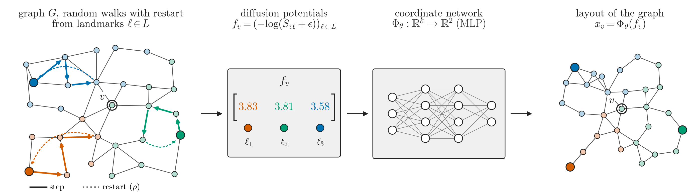
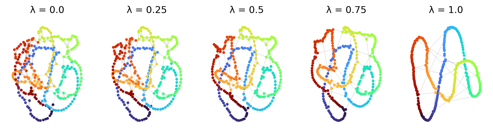

# fling-layout

Graph drawing with a learned layout function. Fling computes a graph layout by fitting a function of node features instead of a table of coordinates.


## From coordinates to a function
Most graph layout methods (stress, ForceAtlas2, t-SNE) optimise the node coordinates directly. Each position is an independent free parameter, and the resulting layout is defined only for the nodes present during optimisation. Incorporating a new node requires re-optimising the layout, which is costly and does not in general preserve the previous drawing.

Fling instead parameterises the layout as a function of node features. Each node is represented by its diffusion potentials to a set of landmark nodes, and a small neural network maps this representation to a position. The network weights are trained on a layout energy, and the drawing is the output of the trained network.


This makes the network inductive. In a growing citation network, for example, newly published papers can be embedded by a single forward pass, without re-optimisation.


```python
model = FlingStress(n_components=2).fit(graph)
# embed new nodes without re-optimisation
pos = model.transform(larger_graph)
```


## Installation

Requires Python 3.10 or newer. The package is `fling-layout` and the module it installs is `fling`.

```
pip install fling-layout
```

This gives you the full library: all four `Fling` variants, the baselines in `fling.baselines` and
the metrics in `fling.metrics`. The required dependencies (numpy, scipy, networkx, torch,
scikit-learn, s_gd2 and fa2-modified) are installed automatically.

Two extras are optional: `figures` adds matplotlib, which only `fling.figstyle` needs, and `large`
adds datashader, pandas, colorcet and pynndescent for drawing graphs with millions of nodes. `all` installs both:

```
pip install "fling-layout[all]"
```

## Library


<p align="center">
  
</p>

Each node carries its diffusion potentials to a set of landmarks. A small network maps that feature
vector to a position, and the weights are trained on a layout energy. The variants differ only
in the energy they minimise.

```python
import networkx as nx
from fling import FlingStress

graph = nx.convert_node_labels_to_integers(nx.les_miserables_graph())
pos = FlingStress(n_components=2, seed=0).fit_transform(graph)
```

A new node is placed with a single forward pass, without refitting.

```python
# set up a 2D stress layout
model = FlingStress(n_components=2, seed=0)

# train the network on the original graph
model.fit(graph)

# place the nodes of a larger graph that contains the original one, without refitting
pos_all = model.transform(larger_graph)
```

`FlingBlend` conditions the field on a weight between two energies, so a single fit covers every weight.

```python
from fling import FlingBlend

model = FlingBlend(n_components=2, seed=0).fit(graph)
early = model.draw(0.0)
late = model.draw(1.0)
```

<p align="center">
  
</p>

### Variants

| class | energy | default iters |
|---|---|---|
| `Fling` | all-pairs stress by majorisation, with a second field for the pair sum | 400 |
| `FlingStress` | scale-normalised pivot stress | 500 |
| `FlingVis` | neighbour embedding plus node–edge clearance and crossings | 2000 |
| `FlingBlend` | a weighted blend of two energies, conditioned on the weight | 1500 |

### Parameters

Shared by all variants.

| name | default | meaning |
|---|---|---|
| `n_components` | 3 | output dimension; use 2 for a drawing |
| `seed` | 0 | random seed |
| `iters` | per variant | optimiser steps |
| `lr` | 0.005 | learning rate |
| `n_landmarks` | 64 | landmarks the diffusion potentials are measured to |
| `alpha` | 0.05 | teleport of the diffusion, which sets how far a node sees |
| `diff_K` | 20 | diffusion steps behind each potential |
| `width` | 128 | hidden width of the coordinate network |
| `depth` | 2 | hidden layers |
| `w0` | 4.0 for `Fling`, 2.0 otherwise | activation frequency, used only by siren, finer and gabor |
| `act` | `gelu` | activation |

Specific to `FlingStress`.

| name | default | meaning |
|---|---|---|
| `npiv` | `None` | number of pivot columns; `None` picks 400, or fewer on small graphs |

Specific to `FlingVis`.

| name | default | meaning |
|---|---|---|
| `w_ne` | 0.3 | weight of the node–edge clearance term |
| `w_cross` | 0.3 | weight of the crossing term |
| `clear` | 0.6 | clearance target as a fraction of the median edge length |
| `n_neg` | 4096 | sampled negatives per step |
| `exaggeration` | 4.0 | attraction factor over the first third of training |

Specific to `FlingBlend`.

| name | default | meaning |
|---|---|---|
| `lam` | `None` | fixes a single weight; `None` trains the whole family |
| `n_lam` | 4 | weights drawn per step, so each step costs `n_lam` objective evaluations |

`alpha` sets how far a node sees. Each potential is a personalised PageRank whose step `k` carries
weight `alpha * (1 - alpha) ** k`, so the mass is spent after roughly `1 / alpha` hops and `diff_K`
only has to be long enough to reach that. Raising `diff_K` alone does nothing, because the weights
have already decayed.

The default sees about twenty hops. Leave it there unless a drawing looks wrong, because the effect
of changing it is large, not monotone, and different on every graph. Measured on sampled stress, a
120 × 120 grid folds at the default and wants a lower `alpha` (0.046 down to 0.012 at 0.01), a 400
× 400 grid draws a clean lattice at the default and gets worse at 0.02 (0.012 up to 0.061), and the
million-node road network is fine at the default but collapses onto a line at 0.005 (0.015 up to
0.274). Sweep it over several seeds and look at the drawing rather than the number.

### Baselines and metrics

`fling.baselines` holds `sgd_stress`, `fa2`, `tsnet`, `tsnet_star`, `NNPNet`, `impred` and the
landmark readouts. `fling.metrics` holds `evaluate`, `normalized_stress`,
`neighborhood_preservation` and `fast_D`. `fling.data` loads the benchmark graphs.

For example, to compare Fling with the sgd² stress baseline on one of the benchmark graphs:

```python
from fling import FlingStress
from fling.baselines import sgd_stress
from fling.data import graphs
from fling.metrics import evaluate

# the benchmark graphs as (name, graph) pairs: grid_400, tree_400, delaunay_600, sbm_240, lesmis
benchmarks = dict(graphs(quick=True))
graph = benchmarks["lesmis"]

# draw it with Fling and with the baseline
pos_fling = FlingStress(n_components=2, seed=0).fit_transform(graph)
pos_sgd = sgd_stress(graph, seed=0)

# score both drawings on the same metrics
print(evaluate(pos_fling, graph))
print(evaluate(pos_sgd, graph))
```

`evaluate` returns a dictionary with normalised stress, neighbourhood preservation (`np_jaccard`,
`knn_recall`), edge length variation (`edge_cov`), edge crossings and the minimum crossing angle.
The crossing metrics are skipped (`None`) on larger graphs, where counting them is slow.

## Tutorial

For a hands-on introduction, work through the
[tutorial notebook](https://github.com/daenuprobst/fling-layout/blob/main/tutorial.ipynb) on GitHub,
or [open it in Google Colab](https://colab.research.google.com/github/daenuprobst/fling-layout/blob/main/tutorial.ipynb).
It draws a first layout, compares graphs of different shapes and real road and mesh networks, fits
on a few nodes and places the rest, adds new nodes without refitting, and compares speed with sgd².
Each section ends with small exercises to try.

## Citation

If you use Fling in your work, please cite:

```bibtex
@misc{inal2026inductivegraphlayoutimplicit,
      title={Inductive Graph Layout with Implicit Neural Fields}, 
      author={Berfin Inal and Daniel Probst},
      year={2026},
      eprint={2608.08876},
      archivePrefix={arXiv},
      primaryClass={cs.HC},
      url={https://arxiv.org/abs/2608.08876}, 
}
```